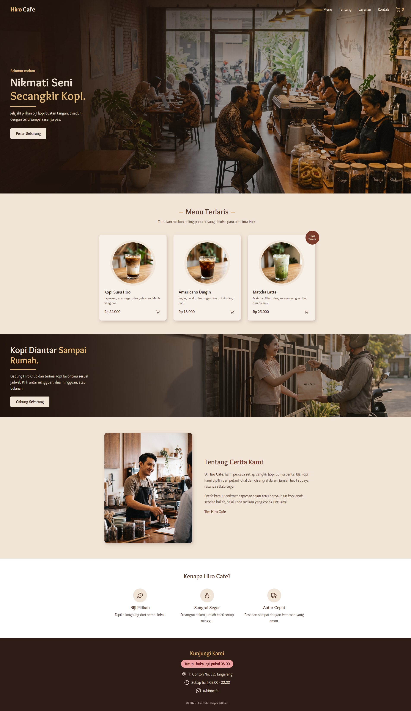

# Hiro Cafe

Landing page konsep untuk sebuah kafe, dibangun dari nol dengan HTML, CSS, dan JavaScript. Proyek ini dibuat sebagai latihan membangun tampilan yang responsif dan interaktif tanpa framework.

**[Lihat demo langsung](https://jerolien.github.io/hiro-cafe/)**



> Proyek konsep untuk latihan. Nama kafe, alamat, menu, dan harga bersifat fiktif.
> Desain terinspirasi dari sebuah landing page kafe, lalu dibangun ulang sendiri dengan kode dan teks yang berbeda.

## Fitur

- Hero dengan foto latar dan overlay gradient, tampil berbeda di desktop dan HP
- Sapaan yang berubah sesuai jam (pagi, siang, sore, malam)
- Status **Buka / Tutup** otomatis berdasarkan jam buka kafe
- Kartu menu dibuat dari data JavaScript, jadi menambah menu cukup menambah satu objek
- Penghitung keranjang yang bertambah saat tombol keranjang diklik
- Navigasi dengan scroll halus dan menu hamburger di layar kecil
- Ikon SVG minimalis, tanpa pustaka tambahan
- Tampilan responsif untuk mobile, tablet, dan desktop
- SEO dasar: `meta description`, Open Graph, teks `alt` pada semua gambar

## Teknologi

| Teknologi | Dipakai untuk |
|---|---|
| HTML5 | Struktur halaman dengan tag semantik |
| CSS3 | Flexbox, Grid, variabel CSS, media query, transisi |
| JavaScript (ES6) | Manipulasi DOM, event listener, array dan `forEach` |
| Google Fonts | Font Overlock |
| Git dan GitHub | Version control dan hosting lewat GitHub Pages |

## Struktur folder

```
hiro-cafe/
├── index.html
├── css/
│   └── style.css
├── js/
│   └── script.js
├── assets/
│   ├── icons/
│   └── images/
│       ├── hero/
│       ├── menu/
│       ├── banner/
│       ├── about/
│       └── og/
└── docs/
    └── screenshot.png
```

## Cara menjalankan

1. Clone repositori ini:
   ```bash
   git clone https://github.com/Jerolien/hiro-cafe.git
   ```
2. Buka folder `hiro-cafe` di VS Code.
3. Klik kanan `index.html`, lalu pilih **Open with Live Server**.

Atau cukup klik dua kali `index.html` untuk membukanya di browser.

## Yang saya pelajari

- Membagi proyek ke file HTML, CSS, dan JavaScript yang terpisah
- Membuat layout dengan Flexbox dan Grid, termasuk `auto-fit` dan `minmax` agar kartu menyesuaikan lebar layar
- Membuat tampilan responsif dengan media query dan `picture` untuk gambar yang berbeda di HP
- Memilih dan mengubah elemen lewat DOM, serta membuat elemen baru dari data array
- Alur kerja Git: `add`, `commit`, `push`, dan `branch`
- Dasar aksesibilitas dan SEO: teks `alt`, atribut `aria`, dan fokus keyboard

## Rencana pengembangan

- [ ] Keranjang yang berfungsi penuh (daftar item, jumlah, total harga) dengan `localStorage`
- [ ] Mode gelap dan terang
- [ ] Menu diambil dari database lewat Node.js dan MySQL

## Pembuat

**Matthew Henshel Hiroshi**
Mahasiswa Sistem Informasi, Universitas Budi Luhur

- GitHub: [@Jerolien](https://github.com/Jerolien)
- LinkedIn: [matthew-henshel-hiroshi](https://www.linkedin.com/in/matthew-henshel-hiroshi)
